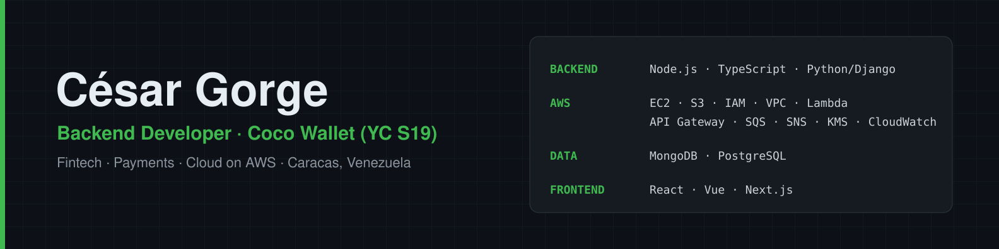

  

# Hi, I'm César 👋

Backend Developer at **Coco Wallet (YC S19)**, a fintech for crypto↔fiat payments in Latin America. Based in Caracas, Venezuela.

- I own the backend end to end: serverless APIs on AWS, payment integrations, security and performance.
- I come from frontend (React, Vue, Next.js), so I like shipping complete features.
- I build with AI in the loop: Claude Code, agents and specs.

**Stack:** Node.js · TypeScript · Python/Django · AWS (EC2, S3, IAM, VPC, Lambda, API Gateway, SQS, SNS, KMS, CloudWatch) · Serverless Framework · MongoDB · PostgreSQL · Jest · ethers.js · React · Vue · Next.js

**Recent:** ⚾ [¡SE FUE!](https://hack.platan.us/26/arcade/se-fue), an arcade baseball game for Platanus Hack 26, built with Phaser 3 in under 50 KB with no external assets.

Most of my work lives in private repos.

📫 [LinkedIn](https://www.linkedin.com/in/cesargorge)
